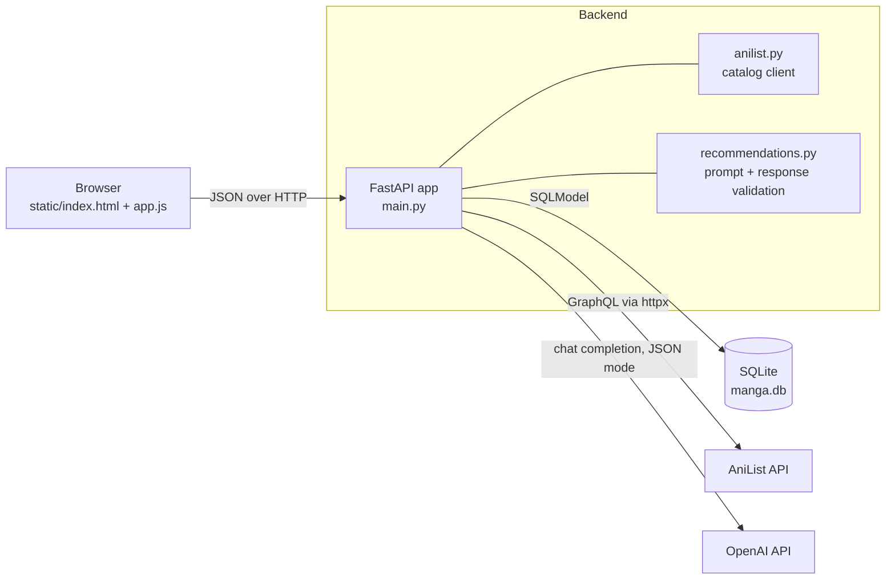
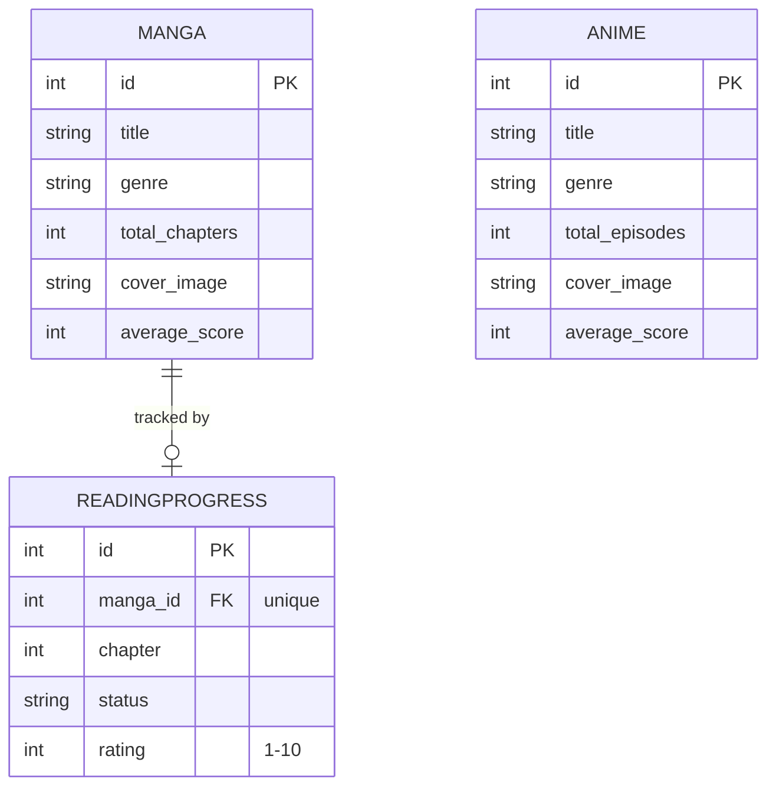

# AniTracker

[](https://github.com/EricValentino/Manga-Tracker-/actions/workflows/ci.yml)

A full-stack manga and anime tracker with LLM-generated recommendations. A FastAPI backend proxies the AniList GraphQL catalog, stores a personal library and reading progress in SQLite, and asks an OpenAI model for suggestions based on what you have actually saved. The frontend is plain HTML, CSS and JavaScript.


## Why I built it

I wanted one place to search real catalog data, keep track of where I am in a series, and get recommendations that reason over my own list instead of a generic top-ten. It was also a way to learn the parts of a web app that tutorials usually skip: talking to third-party APIs that fail, validating input at the boundary, and testing code that depends on services you don't control.

## Features

- **Catalog search**: look up manga and anime through AniList's GraphQL API, with cover art, genres, scores and synopses.
- **Personal library**: save manga, then track chapter, status (reading / completed / plan to read) and a 1–10 rating.
- **AI recommendations**: your saved list is turned into a prompt, the model returns structured JSON, the response is validated (malformed items and titles you already own are dropped), and each pick is enriched with real cover art from AniList.
- **Discover**: trending, top-ranked and popular manga, manhwa (Korean-origin) and anime rows.
- **Detail modal**: full synopsis, genres, score and chapter/episode count for any title.

## Architecture



| Module | Responsibility |
|---|---|
| `main.py` | Routes, HTTP error mapping, cover-art enrichment |
| `models.py` | SQLModel tables plus separate request schemas that enforce validation |
| `database.py` | Engine and session dependency; `DATABASE_URL` override |
| `anilist.py` | One GraphQL helper with timeouts; distinguishes "no match" from "service down" |
| `recommendations.py` | Lazy OpenAI client, prompt building, defensive JSON parsing |
| `static/` | Vanilla JS frontend, GSAP animations |

### Design decisions

- **Request schemas separate from tables.** SQLModel doesn't validate `table=True` models on construction, so bodies are parsed into `MangaCreate`, `ProgressUpdate`, etc. first. A rating of 50, a negative chapter, or a client-supplied `id` never reaches the database.
- **Upstream failures are explicit.** AniList outages and rate limits become `502`, an unknown title becomes `404`, and a missing OpenAI key becomes `503`. Previously these surfaced as `500`s or as `200` responses carrying an error message.
- **Enrichment degrades gracefully.** If AniList can't find cover art for a recommended title, that one card has no image; the response still succeeds.
- **No HTML from external sources is trusted.** Titles, genres, AniList descriptions and model output are escaped before they're rendered.

## API

| Method | Path | Description |
|---|---|---|
| `GET` | `/manga` | List saved manga |
| `POST` | `/manga` | Save a manga (`title` required) |
| `PATCH` | `/manga/{id}` | Update title, genre, chapters, cover or score |
| `DELETE` | `/manga/{id}` | Delete a manga and its progress record |
| `GET` | `/progress` | List progress records |
| `POST` | `/progress` | Create progress for a saved manga (one per manga; `409` if it exists) |
| `PATCH` | `/progress/{id}` | Update chapter, status or rating |
| `DELETE` | `/progress/{id}` | Delete a progress record |
| `GET` / `POST` | `/anime` | List or save anime (API only; see limitations) |
| `GET` | `/search?title=` | Best AniList manga match |
| `GET` | `/search-anime?title=` | Best AniList anime match |
| `GET` | `/discover?sort=&country=` | Top 10 manga; `sort` ∈ `TRENDING_DESC`, `SCORE_DESC`, `POPULARITY_DESC`; optional 2-letter `country` |
| `GET` | `/discover-anime?sort=` | Top 10 anime |
| `GET` | `/details?id=&type=` | Full details; `type` ∈ `MANGA`, `ANIME` |
| `GET` | `/recommendations` | Up to 4 AI picks with cover art |

Interactive docs are served at `/docs` while the server is running.

## Data model



## Running locally

Requires Python 3.10+. An OpenAI API key is only needed for recommendations; everything else works without one.

```bash
git clone https://github.com/EricValentino/Manga-Tracker-.git
cd Manga-Tracker-
python3 -m venv .venv && source .venv/bin/activate
pip install -r requirements.txt
cp .env.example .env        # then add OPENAI_API_KEY
uvicorn main:app --reload
```

Open <http://127.0.0.1:8000/app>.

> Upgrading from an earlier version? Delete the old `manga.db` so the new uniqueness constraint on progress records is created.

## Testing

```bash
pip install -r requirements-dev.txt
pytest -q          # API, client and parsing tests
ruff check . && ruff format --check .
```

The suite runs against an in-memory SQLite database, and AniList and OpenAI are replaced with fakes, so it is fast and needs no network or API key. It covers CRUD paths, input validation, `404`/`409`/`502`/`503` handling, cascade deletion, LLM output parsing, and AniList error mapping. GitHub Actions runs lint and tests on Python 3.10 and 3.12 for every push and pull request.

## Project structure

```
├── main.py               # FastAPI routes and error mapping
├── models.py             # Tables + validated request schemas
├── database.py           # Engine, session dependency
├── anilist.py            # AniList GraphQL client
├── recommendations.py    # LLM prompt + response validation
├── static/               # index.html, app.js, style.css
├── tests/                # pytest suite (no network)
├── requirements.txt      # pinned runtime deps
├── requirements-dev.txt  # + pytest, ruff
└── .github/              # CI workflow, Dependabot
```

## Limitations and next steps

- **Single shared library.** There are no user accounts; everyone using a deployment shares one list. Authentication (likely session- or JWT-based with per-user rows) is the next planned feature.
- **Anime is discovery-only in the UI.** The API can store anime, but there is no anime "My List" or episode progress yet.
- **No migrations.** Tables are created with `create_all`; schema changes currently mean recreating the database. Alembic would fix this.
- **Sequential enrichment.** Cover lookups for recommendations run one after another; an async client with `asyncio.gather` would cut latency.
- **Not deployed.** It runs locally only for now.

## More screenshots


